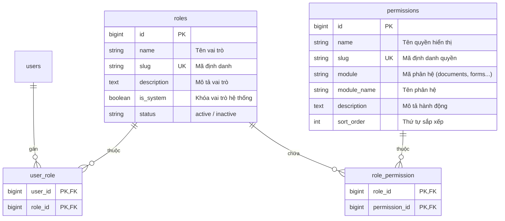

# Kiến Trúc Phân Quyền Hệ Thống (RBAC - Role-Based Access Control)

*Ngày triển khai: 17/10/2026*

## 1. Tổng quan & Mục tiêu

Hệ thống Hỗ trợ Biểu mẫu và Nghiệp vụ được nâng cấp lên mô hình **Phân quyền linh hoạt theo Vai trò & Quyền hạn (RBAC)**, thay thế cho cơ chế kiểm tra `role_id` và `document_role` đơn lẻ trước đây.

Mô hình mới giải quyết các mục tiêu:
1. **Phân quyền đa tầng chi tiết:** Quản lý danh mục vai trò và ma trận quyền hạn cho phép bật/tắt từng hành động trên từng phân hệ.
2. **Bảo tồn tính tương thích ngược 100%:** Giữ nguyên 2 cổng đăng nhập `/login_admin` và `/login`, giữ nguyên các giá trị `users.role_id` và `users.document_role` song song với bảng quan hệ `user_role`.
3. **Giao diện trực quan & hiện đại:** Màn hình quản lý ma trận quyền hạn cho từng vai trò trên Admin với switch On/Off, thống kê theo nhóm phân hệ và thông báo real-time.

---

## 2. Cấu trúc Cơ sở Dữ liệu



---

## 3. Danh mục 26 Quyền Hạn theo 5 Phân Hệ Nghiệp Vụ

### 📄 Phân hệ 1: Quản lý Văn bản (`documents`)
- `documents.view`: Xem kho văn bản & văn bản đến tôi
- `documents.upload`: Đăng tải văn bản mới (đến, đi, quyết định)
- `documents.manage_ledger`: Quản lý & ghi sổ văn bản (Sổ văn bản)
- `documents.distribute`: Phân phối & chuyển tiếp văn bản
- `documents.reports`: Xem báo cáo thống kê văn bản

### 📋 Phân hệ 2: Biểu mẫu nghiệp vụ (`forms`)
- `forms.view`: Tra cứu & xem chi tiết biểu mẫu giao dịch
- `forms.print`: Điền dữ liệu & xuất in file Word mẫu biểu
- `forms.bundle`: Sử dụng & tải gói bộ hồ sơ biểu mẫu
- `forms.manage`: Quản lý danh mục, file Word template & trường mẫu biểu (Admin)

### 💻 Phân hệ 3: Hỗ trợ IT (`it_support`)
- `it_support.request`: Gửi yêu cầu hỗ trợ IT (IPCAS, mạng, máy in, phần mềm)
- `it_support.templates`: Xem & in biểu mẫu đề xuất kỹ thuật IT
- `it_support.manage`: Tiếp nhận, chuyển tiếp & giải quyết yêu cầu IT (Admin/IT)
- `it_support.categories_manage`: Cấu hình danh mục sự cố & biểu mẫu IT (Admin)

### 🔍 Phân hệ 4: Dữ liệu Tổng hợp & Tra cứu (`data`)
- `data.customers.view`: Tra cứu thông tin khách hàng cá nhân / doanh nghiệp
- `data.customers.upload`: Upload nhập file danh sách khách hàng từ Excel
- `data.accounts.view`: Tra cứu thông tin & số dư tài khoản
- `data.accounts.upload`: Upload nhập file danh sách tài khoản từ Excel
- `data.merger_lookup`: Tra cứu sáp nhập địa giới hành chính xã/phường/huyện/tỉnh
- `data.scan_qr`: Sử dụng Camera Scan QR CCCD gắn chip

### ⚙️ Phân hệ 5: Quản trị Hệ thống (`system`)
- `system.users.view`: Xem danh sách tài khoản nhân viên
- `system.users.manage`: Thêm mới, sửa hồ sơ, khóa / mở khóa tài khoản
- `system.branches.manage`: Quản lý danh mục Chi nhánh Loại I, Loại II
- `system.departments.manage`: Quản lý cơ cấu phòng ban
- `system.transaction_offices.manage`: Quản lý phòng giao dịch
- `system.positions.manage`: Quản lý chức vụ & cấp bậc
- `system.roles.manage`: Quản trị Vai trò & Ma trận phân quyền (RBAC)

---

## 4. Bộ Vai Trò Mặc Định & Ma Trận Cấp Quyền

| Vai trò | Slug | Loại | Phân hệ / Quyền mặc định |
|---|---|---|---|
| **Quản trị viên Hệ thống** | `admin` | Hệ thống | Toàn bộ 26 quyền hạn trên cả 5 phân hệ |
| **Kiểm soát viên** | `supervisor` | Hệ thống | `documents.view`, `documents.reports`, `forms.view`, `forms.print`, `forms.bundle`, `it_support.request`, `it_support.templates`, `data.customers.*`, `data.accounts.*`, `data.merger_lookup`, `data.scan_qr` |
| **Nhân viên nghiệp vụ** | `staff` | Hệ thống | `documents.view`, `forms.view`, `forms.print`, `forms.bundle`, `it_support.request`, `it_support.templates`, `data.customers.view`, `data.accounts.view`, `data.merger_lookup` |
| **Văn thư chi nhánh** | `clerk` | Hệ thống | Toàn quyền Quản lý Văn bản (`documents.*`), `forms.view`, `forms.print`, `it_support.request`, `it_support.templates`, `data.merger_lookup` |
| **Quản trị IT** | `it_admin` | Hệ thống | Toàn quyền Hỗ trợ IT (`it_support.*`), `forms.view`, `forms.print`, `data.merger_lookup`, `system.users.view` |
| **Lãnh đạo đơn vị** | `leader` | Tùy biến | Xem & duyệt văn bản, báo cáo, biểu mẫu, tra cứu dữ liệu khách hàng |

---

## 5. Hướng Dẫn Sử Dụng trong Code

### Trong Route (`routes/web.php`)
```php
// Yêu cầu quyền cụ thể
Route::post('uploadfile_customer', [CustomerController::class, 'uploadfile_customer'])
    ->middleware('permission:data.customers.upload');

// Yêu cầu vai trò cụ thể
Route::get('admin/roles', [AdminRoleController::class, 'index'])
    ->middleware('role:admin');
```

### Trong Controller / Service
```php
if (auth_user_can('documents.upload')) {
    // Cho phép upload
}

if ($user->hasRole(['clerk', 'admin'])) {
    // Xử lý logic văn thư
}
```

### Trong Blade Template
```blade
{{-- Dùng Blade Directive --}}
@permission('data.scan_qr')
    <a href="{{ route('scan_qr_code') }}">Quét QR CCCD</a>
@endpermission

{{-- Hoặc dùng helper --}}
@if(auth_user_can('documents.manage_ledger'))
    <a href="{{ route('documents_ledger') }}">Sổ văn bản</a>
@endif
```

---

## 6. Quản Lý Quyền Hạn Trực Tiếp Trên Giao Diện (Permissions Management)

Để thuận tiện khi phát triển tính năng mới mà không phải viết migration thủ công:
- **Tab 1: Danh sách Vai trò & Ma trận quyền**: Quản lý các vai trò, số thành viên, và bật/tắt ma trận 26+ quyền hạn cho từng vai trò.
- **Tab 2: Danh mục Quyền hạn (Permissions)**:
  - Cho phép thêm quyền hạn mới trực tiếp qua giao diện bằng nút **`+ Thêm quyền mới`**.
  - Tự động sinh mã định danh (slug) theo chuẩn `module.action` khi gõ tên quyền.
  - Cho phép chọn phân hệ có sẵn hoặc tự tạo phân hệ nghiệp vụ mới.
  - Checkbox tự động gán quyền mới cho Quản trị viên (Admin) để có thể test ngay lập tức.
  - Bộ lọc phân hệ tức thì và ô tìm kiếm nhanh quyền hạn theo thời gian thực.
  - Cơ chế bảo vệ: Các quyền cốt lõi có cờ `is_system = true` (có biểu tượng 🔒 Hệ thống) được khóa chống xóa nhầm; các quyền tùy biến có thể sửa/xóa linh hoạt.

